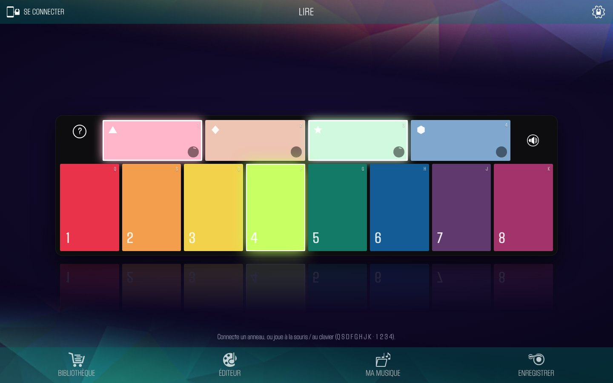

# Bagues musicales — Specdrums Mix en webapp

Recréation en application web de **Specdrums Mix**, l'application de Sphero pour les bagues musicales
**Specdrums**, qui n'est plus maintenue. On tape une couleur avec la bague (ou sur l'écran, ou au clavier)
et chaque couleur du tapis déclenche un son ou une boucle.



*Écran de jeu : deux boucles actives (▲ et ★, liseré blanc) et le pavé 4 en cours de tap.*

- **▶ Démo en ligne : https://bibliogironde.github.io/bagues-musicales/** (version libre : sons synthétisés,
  icônes génériques ; les bagues s'y connectent dans Chrome/Edge, et les groupes de sons d'origine s'y importent).
  Banc de test Bluetooth : https://bibliogironde.github.io/bagues-musicales/test.html
- **⬇ Application à installer (Mac, Windows, Linux)** : voir les [Releases](https://github.com/biblioGironde/bagues-musicales/releases/latest).
- Projet du service **biblio.gironde** (coopérations numériques).
- Fonctionne dans **Chrome ou Edge** (Mac, PC, Chromebook, Android) grâce au Web Bluetooth.
  Sur iPad / iPhone : uniquement via un navigateur Web Bluetooth comme **Bluefy** (Safari ne gère pas le Web Bluetooth).

> ⚠️ **Aucune ressource Sphero n'est publiée ici.** Les sons, la police, les images et les groupes de sons
> appartiennent à Sphero. Le script de construction les lit dans **votre propre APK** Specdrums Mix, pour un
> usage privé. Ne publiez pas le fichier `dist/` ni les archives de sons.

## Fonctionnalités

- Écran fidèle au tapis : 8 pavés numérotés (sons) + 4 pavés ▲ ◆ ★ ⬢ (boucles), couleurs du tapis.
- Moteur audio repris de l'app d'origine : les boucles démarrent ensemble, la première boucle donne le tempo,
  les sons courts sont calés sur la grille (double-croche), sons « maintenus » tant que la bague reste posée.
- Jusqu'à 2 bagues, reconnexion automatique, sortie automatique du bootloader, état batterie/chargeur.
- Éditeur : changer le son ou la couleur d'un pavé, **scanner la couleur d'un objet avec la bague**,
  importer son propre fichier audio.
- Enregistrement (décompte 3-2-1) et **Ma musique** (écoute, téléchargement).
- Bibliothèque : pack « Intro Mix » intégré + import des **63 autres groupes de sons d'origine** (archives .zip),
  conservés dans le navigateur (IndexedDB).
- Jeu sans bague : souris/tactile, ou clavier `Q S D F G H J K` (pavés 1-8) et `1 2 3 4` (▲ ◆ ★ ⬢), `Espace` coupe les boucles.

## Construire l'application

Prérequis : Python 3 (et, en option, `pip install pillow` pour alléger les images).

```bash
python3 tools/build.py --apk /chemin/vers/Specdrums_Mix_1_2_2.apk
# -> dist/specdrums-mix.html (fichier unique, ~3 Mo) : l'ouvrir dans Chrome
```

## Version démo (GitHub Pages)

```bash
python3 tools/build.py --demo     # -> site/index.html, sans aucune ressource Sphero
```

Publiée automatiquement à chaque push sur `main` par `.github/workflows/pages.yml`
(réglage du dépôt : *Settings → Pages → Source : GitHub Actions*). Le pack « Démo synthé » et les icônes
sont générés par `tools/demo_assets.py`.

## Application de bureau (Electron)

Les [Releases](https://github.com/biblioGironde/bagues-musicales/releases) proposent la version démo libre en application :

| Système | Fichier |
|---|---|
| Mac (puce Apple) | `Bagues-musicales-x.y.z-mac-arm64.dmg` |
| Mac (Intel) | `Bagues-musicales-x.y.z-mac-x64.dmg` |
| Windows | `…-windows-setup.exe` (installateur) ou `…-windows-portable.exe` |
| Linux | `…-linux-x86_64.AppImage` |

- L'app n'est pas signée : sur Mac, au premier lancement, faire **clic droit → Ouvrir** ; si macOS indique
  que l'app est « endommagée » : `xattr -cr "/Applications/Bagues musicales.app"`. Sur Windows, SmartScreen :
  *Informations complémentaires → Exécuter quand même*.
- macOS demande l'autorisation Bluetooth au premier « Connecter un anneau ».
- Electron n'ayant pas de fenêtre de choix Bluetooth, l'app affiche sa propre liste « Choisir un anneau ».

Construire soi-même : `cd electron && npm install && npm run dist` (ou `npm start` pour la lancer).
Publier une version : `git tag v1.2.3 && git push --tags` → le workflow `release.yml` construit et publie.

## Récupérer les groupes de sons (facultatif)

Tant que le service Firebase de Sphero reste en ligne :

```bash
python3 tools/fetch_packs.py
# -> packs/specdrums-packs-1.zip … 4.zip (~140 Mo, 64 groupes de sons)
```

Puis dans l'app : **BIBLIOTHÈQUE → IMPORTER DES PACKS (.ZIP)** et sélectionner toutes les archives d'un coup.
Gardez ces archives : c'est votre sauvegarde si le service ferme.

## Outils de diagnostic

`test/specdrums-test.html` : page autonome (sans ressource Sphero) qui se connecte à une bague, affiche
l'inventaire Bluetooth, les trames échangées et les taps. Utile pour vérifier une bague ou un firmware.

## Documentation

- [docs/protocole-ble.md](docs/protocole-ble.md) — protocole Bluetooth des bagues (API Sphero v2, séquence de
  connexion, commandes, format des taps, palette).

## Points d'attention

- Une bague **en charge n'envoie pas de taps** : la débrancher pour jouer.
- Les bagues en firmware 3.x n'acceptent pas les commandes de palette (elles gardent leurs couleurs d'usine).
- Les batteries de bagues restées longtemps sans charge peuvent ne plus tenir (la bague s'éteint dès qu'on la débranche).

## Structure

```
src/index.html          interface + moteur audio + Bluetooth (ressources Sphero en marqueurs %%A:…%%)
tools/build.py          assemble dist/specdrums-mix.html à partir de l'APK (ou la démo libre avec --demo)
tools/demo_assets.py    icônes SVG et pack de sons synthétisé de la démo
.github/workflows/      publication de la démo (Pages) et des applications (Releases)
electron/               application de bureau (Electron) : main.js, preload.js, icône, configuration
tools/fetch_packs.py    sauvegarde locale des groupes de sons d'origine
test/specdrums-test.html  banc de test Bluetooth
docs/protocole-ble.md   protocole des bagues
```
